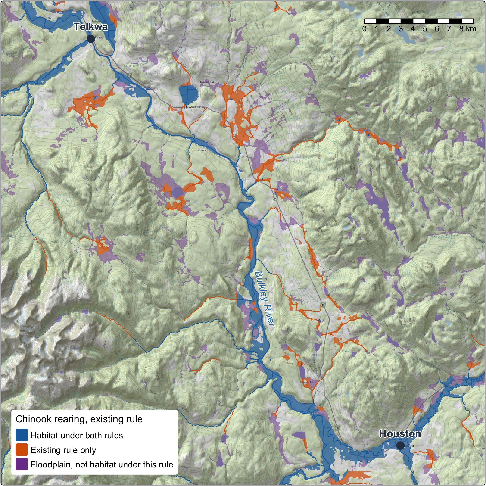
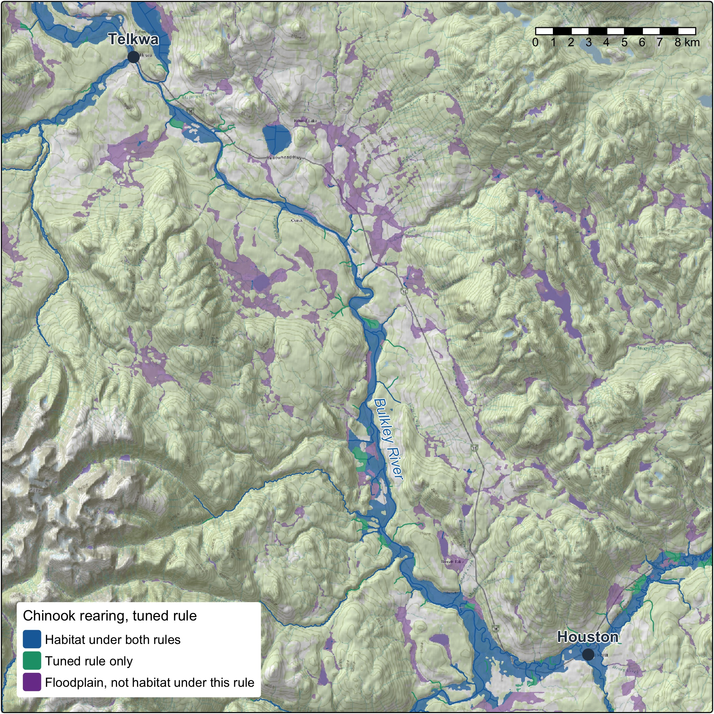
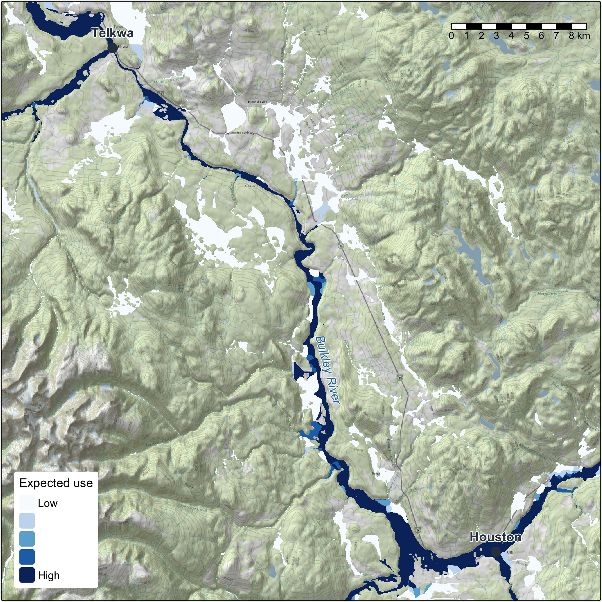
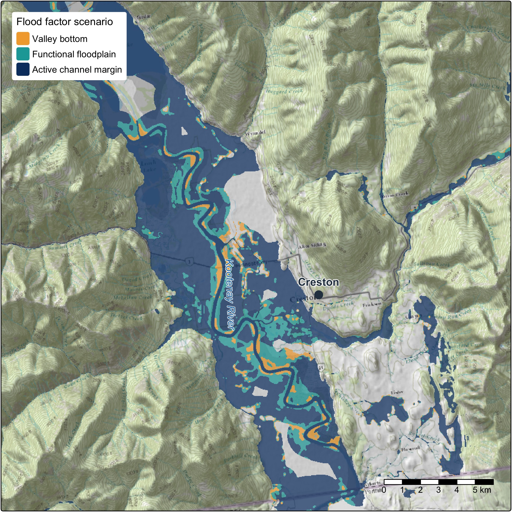
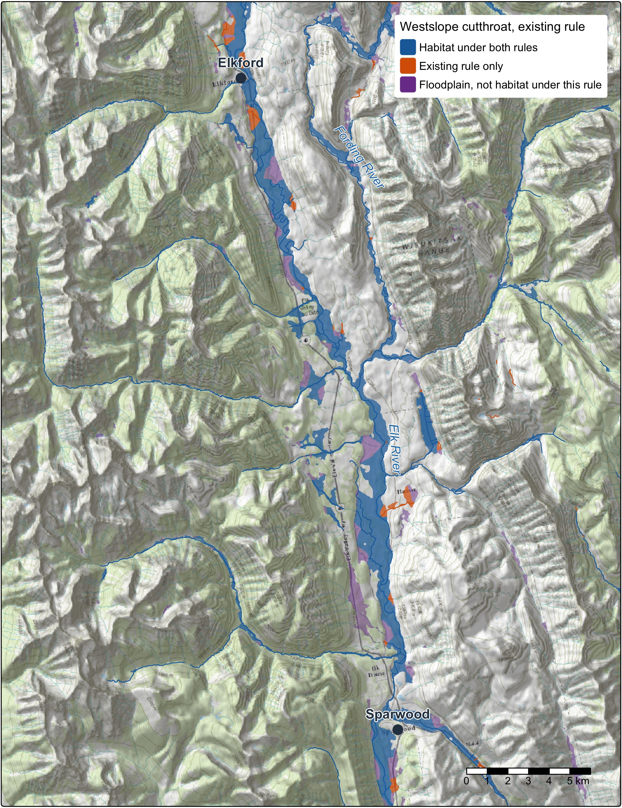
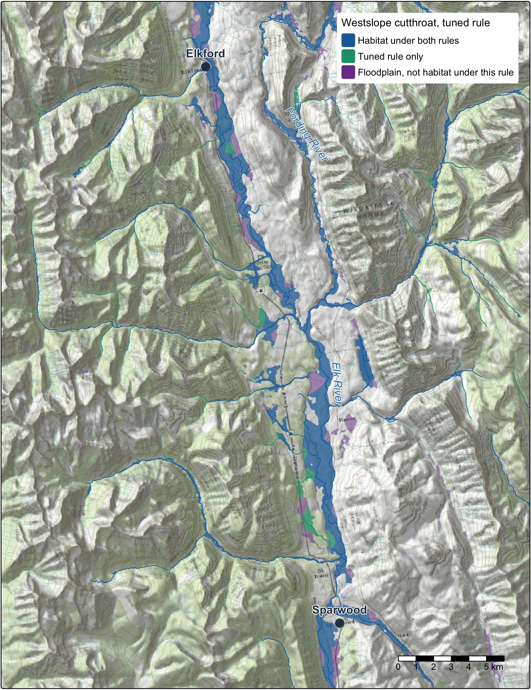
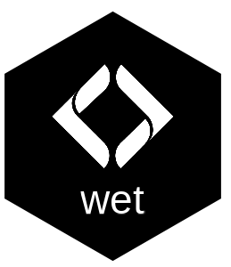
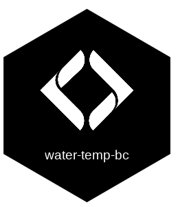

# From fish evidence to floodplain planning

Decisions about where to protect, restore, offset and monitor rest on habitat rules: how steep a
stream a fish will use, how small, how far from a larger river. We start from what is known about each
species: its life history and biology, the flows it depends on and the published work. Then we test
the rules the way science tests anything. Our open tools hold the stream network, the flows and the fish records steady,
change one rule, and score it on watershed groups it was not fitted to, from tens of thousands of
fish surveys across the province. Every result records how it was made, so anyone can check it,
rerun it and build on it.

Then the rule comes off the stream line and onto the ground. It joins one floodplain, drawn group by
group from the whole stream network and published, built to sit beside the wetlands, the largest cottonwood and
mixed forests, the structure of the canopy and the changes on the land. That gives people modelled
areas to plan conservation, restoration and policy on, and a rule can change without redrawing the
ground under it. The work is in the open and moving, and we want to shape what comes next with the
people who use it.

# How habitat mapping is tested and reaches the ground

```{mermaid}
%%| fig-cap: "A rule is tested against fish evidence, then joins one floodplain that everything else can join too."
flowchart LR
  EV["Fish evidence<br/>surveys across<br/>the province"] --> TEST
  LIT["Priors: life history,<br/>biology, published<br/>thresholds"] -. what to expect .-> RULE
  RULE["A habitat rule,<br/>stated"] --> TEST
  FLOW["Flow on almost<br/>every stream, open<br/>and on the Atlas"] --> TEST
  STEADY["Held steady:<br/>network, flows,<br/>records, code"] --> TEST
  TEST(["Scored on watershed<br/>groups held out<br/>of the fit"]) --> LINE["Habitat on<br/>the stream line"]
  LIT -. read against .-> LINE
  LINE -. joins .-> FP(["One floodplain,<br/>keyed to its streams"])
  HEALTH["Wetlands, forests,<br/>canopy structure,<br/>change, climate"] -. joins .-> FP
  FP --> AREA["Areas for conservation,<br/>restoration and<br/>policy planning"]
```

## Testing habitat models with fish sampling records

1. **State the rule, and what the biology leads us to expect.** Westslope cutthroat rear in streams
   below X % gradient, above Y m wide, within Z km of a larger river. Each species' life history and
   the published thresholds, kept as cited quotes checked against their sources, say what a rule
   should look like before any fish record is scored.
2. **Hold everything else steady.** One stream network, one set of flows, one set of fish records,
   one version of the code, each recorded so a run can be traced to exactly what went in.
3. **Test it on fish it has not seen.** Tens of thousands of electrofishing visits across the
   province [@provinceofbritishcolumbia2022FisheriesData], each one a fish caught or not caught. Rules are scored on whole watershed groups held
   out of the fit. The model accounts for how much stream was fished, which data set a record came
   from, its period and its group, so a rule is not credited for a difference in sampling.
4. **Compare before and after.** The tested rule sits beside the current one on the same network:
   which streams change, by how many kilometres and hectares, and whether the choice holds when the
   groups are split other ways. The result is read against what the literature led us to expect. Where the evidence cannot decide, the method says so, and that shows
   where the next sampling belongs.
5. **Document it so it can be rerun.** Every setting that shapes a result sits in one register, and
   a test fails if it and the code disagree. Published figures are computed from the tables. Nothing
   is promoted until a person signs off.

## Biology, fish surveys and stream flow: three lines of evidence

The test does not rest on any one dataset. Priors come first: each species' life history and biology,
and the published thresholds. Fish surveys test those priors, and flow is what the rules read. Where
they agree a rule stands on all three, and where they part is the place to look next.

## Predicting flow on almost every stream in the BC Freshwater Atlas

Fish live by water, so the rules read flow. [wet](https://www.newgraphenvironment.com/wet/) estimates
how much water flows in almost every stream in British Columbia, month by month, tied to the
Freshwater Atlas stream by stream, and publishes it openly so anyone can read it [@wet]. That lets a rule set
a real flow floor rather than a proxy for one, ask how far a stream sits from a river of a given size,
and read flow in the weeks a life stage needs it.

![Where each larger river's flow comes from. Most take the Pacific Climate Impacts Consortium's routed model [@schnorbus2018VICGlacierVICGL; @craig_etal2020Flexiblewatershed], placed on Atlas streams by our open database fork [@norris_irvine2026NewGraphEnvironmentfwapg]. An open water balance [@chapman_etal2018WaterAllocation] fitted to Water Survey of Canada gauges fills in where that model does not reach or reads far too low.](fig/habitat-rules_flow-sources.png){fig-alt="Map of British Columbia's larger rivers coloured by the source of their flow: routed model across most of the province, water balance in the far north and the Nechako Reservoir"}

## Joining fish habitat to floodplain mapping

Habitat is modelled on the stream line, and people plan on the ground. So we do not cut a floodplain
to fit each rule. We draw one floodplain from the whole stream network of the Freshwater Atlas [@flnrord2021FreshwaterAtlasb], using valley confinement [@nagel_etal2014LandscapeScale; @hall_etal2007Predictingriver], and key every cell to the
stream it belongs to, and habitat joins to it: each cell takes the nearest segment on its
own stream.

That changes what a new question costs. A new rule, another species, a partner's own rule set or a
recovery team's definition is a new join on the same ground. Two rules compare hectare for hectare,
in floodplain hectares and in hectares weighted by how likely fish are to use them, as well as in
kilometres.

::: {.column-page layout-ncol=2}
{fig-alt="Map of the Bulkley River floodplain showing chinook rearing habitat under the existing rule, with the part only that rule holds in orange"}

{fig-alt="Map of the same floodplain showing chinook rearing habitat under the tuned rule, with the part only that rule holds in green"}
:::

{fig-alt="Map of the same floodplain shaded from low to high expected use, darkest along the Bulkley River mainstem"}

## Floodplain and riparian health metrics to inform conservation and restoration

A floodplain holds more than its habitat line. The same ground is where the conservation and
restoration puzzle comes together:

- **Where the value is.** Wetlands, the ponds beavers make, and the forests that shade the water, hold the
  banks and drop wood into the channel. Tying the floodplain to the vegetation resources inventory
  lets us key in on its largest cottonwood and mixed forests.
- **How it is doing.** Lidar point clouds show the forest's structure, through canopy height and
  rumple, how uneven the canopy surface is. Land-cover change shows where the floodplain is shifting and what mapped fire, harvest or
  other layer overlaps it. How far the local climate has moved can sit beside both.
- **Whatever comes next.** Any other mapped layer, from ecosystem type to protected areas, is
  one entry in a settings file, not new code.

The design is one floodplain, a modelled screen of where to look, so the same ground
points to where to protect, where to restore and what policy should cover, for the people who know
the place to weigh. The areas add up from a reach to a region.

## Options for the terrain and spread of water in floodplain modelling

The floodplain is a model, and it is built to be steered:

- **The terrain under it:** any elevation model works: the national 30 m one, provincial lidar, or
  one built from the point clouds. Ordinary drones are the next step on that path, with proofs of
  concept for their elevation models and point clouds and for tying them to the lidar.
- **How far it reaches:** from the active channel margin to the whole valley bottom.
- **How it is drawn:** the parameters in [flooded](https://www.newgraphenvironment.com/flooded/),
  which keeps improving as what we need and what we know move.

{fig-alt="Map of the Kootenay River flats with the active channel margin, functional floodplain and valley bottom drawn nested in three colours"}

Within one comparison the floodplain is held fixed, like the network and the flows, and its checksum
and run record say which one it was. Changing it is a before and after of its own.

## Stream temperature and water quality

The method works the same whichever variable it tests. Stream temperature is well on its way: station
records in [water-temp-bc](https://www.newgraphenvironment.com/water-temp-bc/), gap filling and degree
days in wet, and weekly stream temperature modelled with Poisson Consulting in the Nechako and the
Skeena [@hill_etal2024Spatialstream; @hill_etal2025Spatialstream]. Temperature on every segment, validated on held-out sites, takes it through the same test.
Water quality and habitat degradation follow the same path: hold the network and the fish evidence
steady, change one variable, score it on held-out data and show the before and after.

## Collaboration for what comes next

This work is in progress and built in the open, and we want to shape where it goes with the people it
affects.

Working with First Nations means their priorities shape the work and their knowledge stays theirs.
Provincial and federal managers can check a rule, rerun it and tell us what recovery and offset work
need from it. Restoration and stewardship groups know their streams, and their surveys and their read of
a rule are what sharpen it.

The tools keep moving as the evidence and the questions do. Choosing which rule, which flows and which
floodplain fit a question on a real river is where the work is, and that is the part we would like to do
with you.

## Chinook and westslope cutthroat: visualizing how evidence results in change

The same steps apply to each species tested, and two of them show what the method does when the evidence can
carry a change and when it cannot.

**Where the evidence can carry a change, it names a new rule.** For chinook rearing the fish records support a
different rule from the current one. The
[chinook rearing article](https://www.newgraphenvironment.com/knowledge/articles/chinook_rearing.html)
walks through it: the candidate rules, the choice, and whole runs compared stream by stream.

**Where the evidence is thin, the method says so.** The Pacific populations of westslope cutthroat
are listed under the Species at Risk Act, so a rule for them has to stand on its evidence. The chain
records where the evidence leans and says how weak that lean is, and the rule applied stays as it is
until the evidence can carry a change. The next step strengthens it: resident populations above falls
and steep reaches define much of this species' range, so they come in where an independent fish
record shows a population, and a survey never counts only because it caught fish.

**How streams are cut into segments is the next thing to test.** Tuning on a network with fewer cuts means
the place a fish was caught stops shaping the gradient that scores it, and it shows how much the cuts
move a rule. That starts with chinook rearing.

::: {.column-page layout-ncol=2}
{fig-alt="Map of the Elk River floodplain and streams from Sparwood to Elkford showing westslope cutthroat rearing habitat under the existing rule, with the part only that rule holds in orange"}

{fig-alt="Map of the same valley showing westslope cutthroat rearing habitat under the tuned rule, with the part only that rule holds in green"}
:::

The tests go beyond a single stream-size cut-off. They cover gradient, channel width, discharge, and the distance from a
site to the nearest larger river at a range of river sizes, with flows from more than one model. That
is how a stream's position in its network shapes its use.

## A future of recovery, restoration, defensible offsets and accurate effectiveness monitoring

- **Species at risk recovery:** habitat definitions with stated confidence, to support critical
  habitat identification and recovery actions.
- **Watershed security:** rules tied to stream flow and to the connections between small streams and
  large rivers show which habitat depends on which flows.
- **Conservation and restoration planning:** habitat kilometres and floodplain hectares from tested
  rules, beside the largest forests and the condition of the ground.
- **Habitat offset accounting:** gains and losses measured with the same tools, before and after,
  with every input versioned, so the accounting can be audited.
- **Monitoring:** new surveys, new flows or a new network rerun the same chain and show what changed
  and why.

## The packages and catalogues behind the work

All of it is open code, and each run keeps a record of what it did.

| | |
|:--|:----|
| {height=110px fig-alt="fresh hex sticker"} | **[fresh](https://www.newgraphenvironment.com/fresh/)**. The stream network engine [@fresh] on the BC Freshwater Atlas, through fwapg. It places surveys on streams, walks the network and applies habitat rules. |
| {height=110px fig-alt="link hex sticker"} | **[link](https://www.newgraphenvironment.com/link/)**. Habitat and access for each species across the province, from configurable rules [@link], reproducing the approach of bcfishpass [@norris2024smnorrisbcfishpass]. |
| {height=110px fig-alt="wet hex sticker"} | **[wet](https://www.newgraphenvironment.com/wet/)**. Modelled stream flow, and water temperature at stations [@wet]. |
| {height=110px fig-alt="knowledge hex sticker"} | **[knowledge](https://www.newgraphenvironment.com/knowledge/)**. The evidence and the testing [@knowledge]. It holds the cited literature and life histories, assembles the fish records, tunes and compares rules, and publishes the results with their provenance. Its [methodology article](https://www.newgraphenvironment.com/knowledge/articles/habitat_thresholds.html) is the reference for how a rule is tested. |
| {height=110px fig-alt="flooded hex sticker"} | **[flooded](https://www.newgraphenvironment.com/flooded/)**. Draws the floodplain from terrain and joins habitat to it by position [@flooded]. |
| {height=110px fig-alt="drift hex sticker"} | **[drift](https://www.newgraphenvironment.com/drift/)**. What changed on the floodplain and when, from land cover [@drift]. |
| {height=110px fig-alt="cd hex sticker"} | **[cd](https://www.newgraphenvironment.com/cd/)**. How far the climate has moved, over any area. |
| {height=110px fig-alt="fly hex sticker"} | **[fly](https://www.newgraphenvironment.com/fly/)**. Historic airphotos, the baseline that shows what to restore toward: a story of its own. |
| {height=110px fig-alt="water-temp-bc hex sticker"} | **[water-temp-bc](https://www.newgraphenvironment.com/water-temp-bc/)**. Stream temperature records from stations across the province. |

[floodplains](https://www.newgraphenvironment.com/floodplains/) runs link, flooded and drift over a watershed group from one config per area. Each run's record answers two questions separately: did the same ingredients go in, and did the same result come out.

Our catalogues, searchable by place and time:

::: {.column-page layout-ncol=5}
::: {}
**[stac-elevation-bc](https://www.newgraphenvironment.com/stac_elevation_bc/)**

The ground under the trees, found by place, rebuilt monthly.
:::

::: {}
**[stac-pointcloud-bc](https://www.newgraphenvironment.com/stac_pointcloud_bc/)**

The raw lidar points, for canopy height, elevation models and comparing flights, rebuilt monthly.
:::

::: {}
**[stac-floodplains-bc](https://www.newgraphenvironment.com/stac_floodplains_bc/)**

Mapped floodplains, and how the land in them changed: the floodplain rules join to.
:::

::: {}
**[stac-airphoto-bc](https://www.newgraphenvironment.com/stac_airphoto_bc/)**

Historic airphotos, findable by place: what to restore toward.
:::

::: {}
**[stac-uav-bc](https://www.newgraphenvironment.com/stac_uav_bc/)**

Our drone flights: imagery and elevation models, before and after the work.
:::
:::

Basemap on the maps: Esri World Topographic Map and World Shaded Relief.

The
[Open Source page](https://www.newgraphenvironment.com/project/open_source_software/) has the current
tools and catalogues.

# References

::: {#refs}
:::
