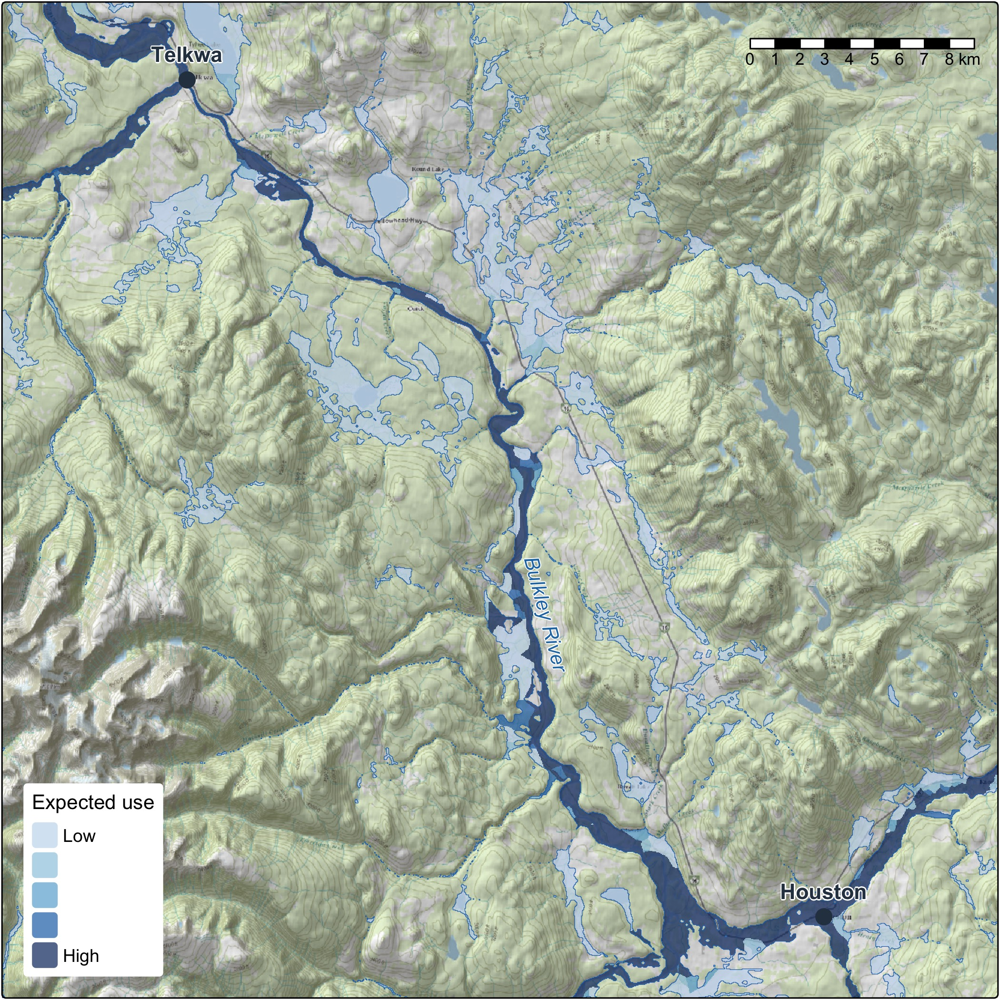

Where should we protect, restore, offset and monitor? People answer those questions on a real river, and
modelled habitat, flow and floodplains help them see where to look. This series tells how that modelling works today
and where it is going, one plain story at a time, with maps. It is written for the people who use the
results or weigh them: First Nations, managers, funders, stewardship groups and practitioners.

{fig-alt="Map of the floodplain along graded streams on the Bulkley River, shaded from low to high expected use, darkest along the mainstem"}

# How the chapters fit

Each chapter stands on its own, and together they are built as one system. Fish evidence and flow test a
rule, the rule joins one floodplain, and people see the work through reports, tables and maps. Some of this
runs today and some is still being built, and each chapter says which.

```{mermaid}
%%| fig-cap: "The chapters of the series, by number, and how they connect as the system is designed. Some of these connections run today and others are still being built."
flowchart LR
  FLOW["4. Flow"] --> RULES["1. Habitat rules"]
  RULES --> FP(["3. One floodplain"])
  HEALTH["5. Floodplain health"] --> FP
  CHANGE["6. Change and airphotos"] --> FP
  CAT["7. Catalogues"] <--> FP
  CAT --> HEALTH
  CAT --> CHANGE
  FP --> REPORT["2. Reports"]
  CAT --> REPORT
  FP <--> STEER["8. Steering"]
  STEER --> RULES
```

# The chapters

The first is out. The others are still to come, and each is linked here once its post is up.

1. **[Habitat rules, from fish evidence to floodplain planning](../2026-11-01-habitat-rules-tested/index.qmd).**
   How a rule is tested against fish surveys across the province, and how it comes off the stream line
   and onto the ground.
2. **What a New Graph report is.** What people can do with one: see the work, filter and export its
   tables, cite it and rerun it.
3. **One floodplain, keyed so anything can join.** Why a new rule or a new layer is a join on the same
   ground, not a new map.
4. **Flow on almost every stream.** How much water runs in the streams of British Columbia, month by
   month, and what a habitat rule can do with that.
5. **Floodplain and riparian health.** Wetlands, beaver ponds, the largest cottonwood and mixed forests,
   and the structure of the canopy, built to be read together on one floodplain.
6. **Floodplain change and the airphoto baseline.** What has changed on the land and when, and what
   historic airphotos show about what to restore toward.
7. **The catalogues.** The open imagery, elevation, point clouds and floodplains behind the work, and how
   to find them by place and time.
8. **Steering.** Where this is heading: other people running the models for their own places, and a
   review on screen and in the field feeding the next run.

# What runs through every chapter

- **Numbers that stand up.** Decision rules written before results, testing on data held out of the fit,
  reproducible builds and a record of how each result was made. Where a chapter has a result, it shows
  which of these stand behind it and says where the result is still a modelled screen.
- **Seeing it.** Reports, interactive tables, webmaps and maps are how the work reaches the people who
  decide, so every chapter carries figures.
- **Adding it up.** How the pieces can become gains, losses and priorities, and how far that has come.

# What comes next

This is work in progress, built in the open, and we want to shape it with the people it affects. Working
with First Nations means their priorities shape the work and their knowledge stays theirs. Managers can
tell us what recovery and offset work need from a rule. Stewardship groups know their streams, and their surveys and their read of a
rule are what sharpen it. Choosing what fits a question on a real river is where the work is, and that is
the part we would like to do with you.
